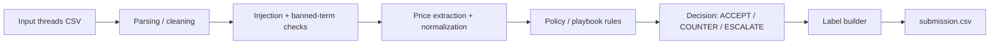

# The Procurement Desk – <Team Name>

> Fill every <ANGLE BRACKET> from your real code. Delete anything your code does not do.

## 1. Overview
<How a thread goes in and a label comes out: parse thread -> extract prices/terms -> check policies -> decide ACTION:REASON:COUNTER_PRICE.>

## 2. Mathematics
For each formula, copy it from the code and say which function implements it.
- Price normalization: <formula, function name, file>
- Concession schedule L(r): <formula>
- Counter rounding: <rule, e.g. round to nearest X, whole INR>
- Approval limit: <formula / threshold>
- <any other equation>

## 3. Architecture

<Edit the boxes to match your real pipeline.>

## 4. Implementation
| File | Role | LLM or rule-based? |
|---|---|---|
| <file.py> | <what it does> | <LLM / rules> |

## 5. AI models & APIs
Model names: <...> | Prompt strategy: <...> | API calls: <number> | Cost / free tier: <...>
(If you used no LLM, say so.)

## 6. Tricky cases
Prompt injections: <> | Banned terms: <> | Amendments: <> | Supplier contracts: <> | Trading names: <> | Currencies: <> | Corrections: <> | Multi-price messages: <>

## 7. Evaluation
Accuracy on worked examples: <real number> | Error analysis: <> | Changes between submissions: <>

## 8. Real-world application
<How a procurement team would use it; what is needed to deploy safely (human review for ESCALATE, audit logs, limits).>

## 9. Drawbacks & limitations
<Real failure modes and unsafe situations.>

## 10. Original work & disclosures
Built by us: <> | External libraries: <> | Templates / external code: <> | AI coding tools used: <name and what for>

## 11. How to run
```bash
git clone <repo-url> && cd <repo>
python -m venv .venv && source .venv/bin/activate
pip install -r requirements.txt
<command that regenerates the final CSV>
```
Output: `<path>/submission.csv` (identical to the file selected on Kaggle).
